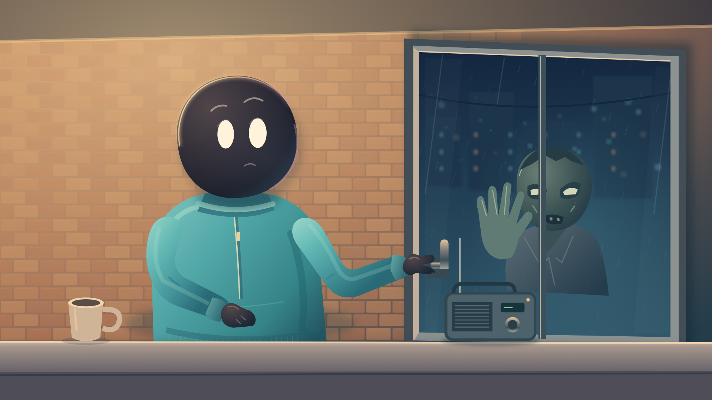
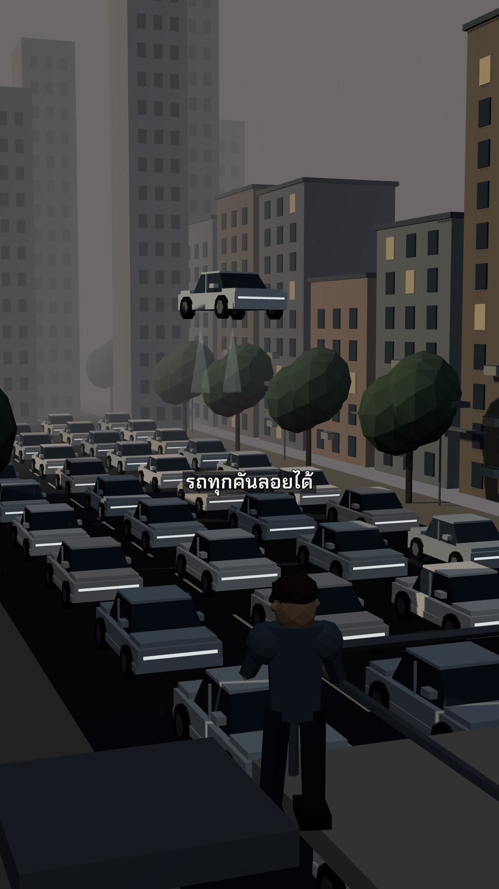

# JK Animation Studio

## เลือกสไตล์สำหรับงานใหม่

ยังไม่คุ้นโครงสร้าง? อ่าน [โฟลเดอร์ ไฟล์ และความต่างของ skills](STRUCTURE.md) ก่อน — แยกสิ่งที่ใช้ร่วมกันจาก renderer และ source ตัวอย่างแต่ละรุ่น


รัน `npm run styles` เพื่อดูรายชื่อสไตล์ แล้วอ่าน `styles/<id>/STYLE.md` ของแนวที่เลือก ดู [แผนผังโปรเจกต์](WORKSPACE.md) — ไม่มี UI ใน studio/ UI ผลิตภัณฑ์อยู่ในเว็บ kubcode (kubcode.dev)

- **GrowKaz Stickman / Thai Survival:** มีคลิปจริงแยก Claude Code, Codex CLI และฉบับ Claude → Codex ให้สลับดู
- **FreshStack What If:** มีตัวอย่าง OpenCode + GLM และเสียงไทย ElevenLabs; ยังไม่มีเวอร์ชัน Claude/Codex จึงไม่ติดป้ายว่าเป็นคู่เทียบ
- แนวเดิมและแนวทดลองคงสถานะของตนเอง การเลือกสไตล์ไม่เท่ากับอนุมัติภาพ/เสียงใหม่หรือเริ่มงานเสียเงิน
- สไตล์ต่าง renderer ต้องใช้ kit ของตนเอง อย่าใช้คำสั่ง HyperFrames กับ Remotion หรือ GrowKaz โดยอัตโนมัติ

Private style and production library for code-based videos. เริ่มจาก **JK Soft Story v2** ที่ผู้ใช้เลือกเมื่อ 28 ตุลาคม 2026 พร้อมภาพต้นแบบ SVG ชิ้นส่วน และผู้บรรยายไทย สุขุม

## Clone and start

ต้องมีสิทธิ์เข้าถึง private repo และ Node.js 22+:

```bash
git clone https://github.com/JK369x/jk-animation-studio.git
cd jk-animation-studio
npm ci
npm run doctor
npm test
npm run check
npm run styles
```

## ใช้กับ Claude หรือ Codex

เปิด agent ใน folder repo นี้ แล้วสั่ง:

> อ่าน AGENTS.md, DIRECTOR.md และ TECHNIQUE.md ดูสไตล์ที่มีให้เลือก แล้วทำงานด้วย JK Soft Story และผู้บรรยายไทย สุขุม ให้ฟังเสียงก่อนสร้างภาพ

มี project skills ใน .agents/skills/ และ CLAUDE.md ชี้ workflow เดียวกัน Agent ที่ไม่ค้น project skills อัตโนมัติสามารถอ่านไฟล์ SKILL.md โดยตรง ไม่ต้องใช้ path ของเครื่องผู้สร้าง

## สไตล์ที่มี

| Style | Status | Example |
|---|---|---|
| [JK Soft Story v2](styles/jk-soft-story/STYLE.md) | เลือกแนวภาพนิ่งแล้ว; motion/เสียงตรวจแยก | [ภาพ](styles/jk-soft-story/assets/selected-v2.png), [คลิป 8s](styles/jk-soft-story/examples/motion/demo.mp4) |
| [Low-poly Urban](styles/low-poly-urban/STYLE.md) | ผ่านภาพ/motion ตัวอย่าง 8s · ซับล่าสุดไทยไฮไลต์ + อังกฤษเล็ก ผ่าน 29 ต.ค.; เสียงตรวจแยก | [ภาพ](styles/low-poly-urban/assets/preview.png), [คลิป 8s](styles/low-poly-urban/examples/city/demo.mp4) |

### JK Soft Story



### Low-poly Urban — selected v0.3



คลิปตัวอย่างทั้งสองไม่มีเสียง ใช้ดูภาพและ motion เท่านั้น เลือกสไตล์จาก `npm run styles` แล้วอ่าน STYLE.md ของแนวนั้น แต่ละแนวมี STYLE.md ของตัวเอง ไม่ผสมภาพอัตโนมัติ ส่วนซับคลิปบรรยายไทยใช้ค่าเริ่มต้นล่าสุด: **ไทยไฮไลต์คำสำคัญ + อังกฤษตัวเล็กใต้ไทย** ตาม [คู่มือซับ](shared/captions/STYLE.md) ที่อนุมัติ 29 ต.ค. 2026 เว้นแต่สั่งรูปแบบอื่นหรือไม่เอาซับ

คลังนี้ยังไม่ได้มีทุกสไตล์ของ Lemo และไม่ได้คัดลอก renderer ของ Lemo มาใช้ ดู [DIRECTOR.md](DIRECTOR.md) สำหรับวิธีเล่า/ภาพ/เสียง และ [TECHNIQUE.md](TECHNIQUE.md) สำหรับเครื่องมือ/การเรนเดอร์

## เพิ่มสไตล์

```bash
npm run new-style -- paper-noir
```

สร้าง styles/paper-noir/STYLE.md และ style.json เป็น draft โดยไม่ทับของเดิม เติม guide, ภาพ, source และ component แล้วใส่ paths ใน metadata เปลี่ยน status เป็น selected เฉพาะเมื่อผู้ใช้เลือกจริง จากนั้น npm run check

## ภาพและวิดีโอ

```bash
npm run hf:check
npm run hf:snapshot
```

มีตัวอย่าง HyperFrames ภาพนิ่ง 1 วินาทีที่ styles/jk-soft-story/examples/still และ component hero/radio SVG แยกแล้ว เมื่อรวมหลาย component ต้อง prefix ids ไม่ให้ชนกัน มี motion study 8 วินาทีของแต่ละแนวพร้อม source แต่ยังไม่มี motion engine/IK หรือคลิปที่อนุมัติให้ผลิตทั้งตอน

## ผู้บรรยายไทย สุขุม (เสียงบรรยาย)

รวม reference WAV และ helper แล้ว โมเดลขนาดใหญ่ไม่อยู่ใน Git ให้ติดตั้งและดาวน์โหลดครั้งแรกบน **Mac Apple Silicon**:

```bash
# Install Python 3.11+ and FFmpeg first; e.g. on macOS:
brew install python@3.12 ffmpeg
npm run setup:voice
.venv/bin/python shared/voice/scripts/narrate.py --lines shared/voice/example-lines.json --out outputs/voice
```

ดู [voice setup](shared/voice/README.md) สำหรับ check/dry-run และข้อกำหนด ส่วน Windows/Linux ใช้สไตล์ ภาพ และเสียงที่มีได้ แต่สร้างเสียงด้วย MLX helper นี้ไม่ได้ ไม่รับประกัน delivery เหมือนกันทุกครั้งข้ามฮาร์ดแวร์

## Layout

- styles/<id>/ — metadata, STYLE.md, selected assets, reusable components, examples, study references
- shared/voice/ — original JK reference/profile/helper and pinned primary requirements
- shared/captions/ — Thai highlighted phrase overlay treatment
- .agents/skills/ — repository-local agent entrypoints
- scripts/ — catalog, draft scaffolding, doctor, voice setup
- tests/ — catalog/overwrite and relocated voice-bundle checks

## Privacy and rights

Credentials, model weights, runtime caches, generated outputs and local logs are excluded. Source inspiration screenshots are included for private study with provenance, not as production assets or an open-source license. See [THIRD-PARTY.md](THIRD-PARTY.md). Only GitHub collaborators granted access can clone a private repository; this setup does not automatically invite anyone.

## YouTube and Instagram

รวม project skills: [YouTube](.agents/skills/youtube/SKILL.md), [Upload workflow](.agents/skills/youtube-api-upload/SKILL.md) และ [Instagram](.agents/skills/instagram/SKILL.md) โดยต้องเลือกช่อง/บัญชีให้ตรงงานก่อนเสมอ การทำคลิปไม่ถือว่าอนุญาตให้อัปโหลด

ชั้น social API ใช้ **Bun + Elysia** แยกจาก Node/HyperFrames และ Python ที่ใช้กับเสียง อ่าน [setup และ endpoint ที่มีจริง](social-api/README.md) ปัจจุบัน starter รองรับ inventory และ live identity verification; workflow อัปโหลด/Insights/ตั้งเวลาอยู่ใน skill แต่ยังไม่มี endpoint เหล่านั้น ไม่มี token หรือบัญชีเดิมติดไปกับ clone

~~~sh
cd social-api
bun install --frozen-lockfile
# Configure a private .env and your own selected profiles; see the runtime guide.
bun run start
~~~

ทดสอบด้วย npm run test:social จาก root ไม่มีการเรียกบัญชีจริงใน test

## ปกคลิป — ค่าเริ่มต้นที่เลือกแล้ว

ใช้ ChatGPT gen ปกจากตัวละคร/ฉากจริงของคลิปเป็น reference จัดภาพและตัวหนังสือให้ชัด ถ้าเป็นตอนให้คนดูโหวต ต้องเห็นคำชวนคอมเมนต์และชื่อทางเลือกครบ อ่าน [คู่มือและตัวอย่างที่ผ่าน](shared/covers/STYLE.md) แนวทางนี้ใช้กับปก ไม่เปลี่ยนวิธีทำแอนิเมชันด้วย HyperFrames

## Narrated low-poly mall episode workflow

For mall episodes and revisions, load [.agents/skills/jk-low-poly-beats/SKILL.md](.agents/skills/jk-low-poly-beats/SKILL.md) and use [pipelines/low-poly-beats-v1](pipelines/low-poly-beats-v1/README.md). This is the executable low-poly camera/reveal/caption/SFX path. The separate JK Window pilot is not its renderer. Build a new versioned directory from a validated plan; shared speech/event anchors must drive related actions and captions. Check the actual exported film. Do not fall back to the old standalone compose.py while claiming these improvements were used.
