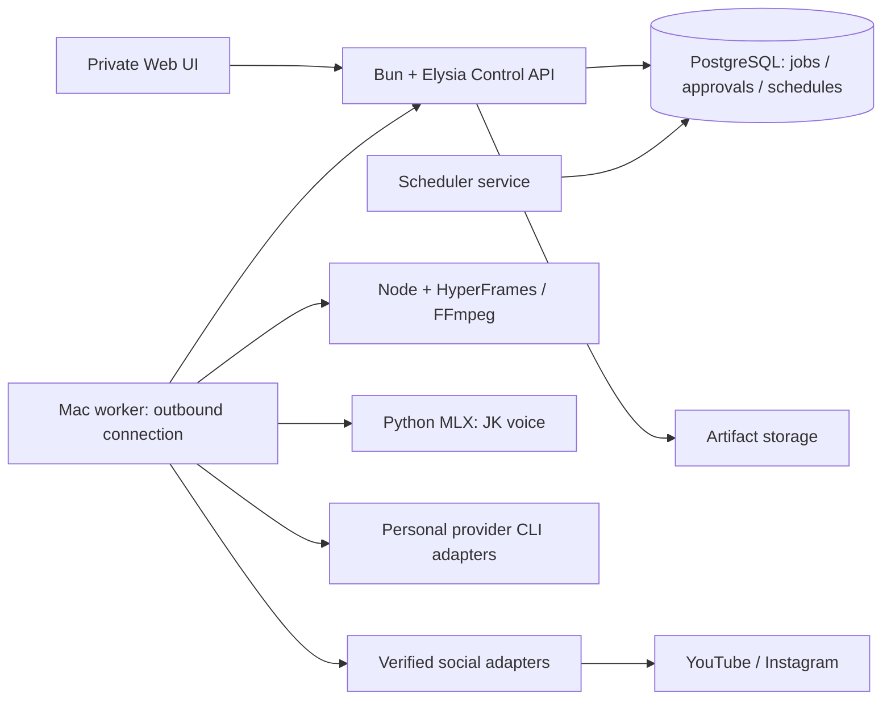

# JK Studio — แบบเว็บส่วนตัวและ Podcast

> **Superseded direction (2026-11-11, owner):** the real AI Studio is built on kubcode.dev (repo `JK369x/kubcode`), not by growing this repository into a web app. Keep this plan as research input only. See `docs/adr/0001-ai-studio-on-kubcode.md`.

วันที่ตรวจ 29 ตุลาคม 2026 · ขั้นออกแบบเท่านั้น · ยังไม่ได้เพิ่ม production route, style, scheduler, credentials หรือเผยแพร่เนื้อหา

## ข้อเสนอหลัก

ต่อยอด `jk-animation-studio` เป็น **สตูดิโอส่วนตัวที่ใช้เว็บควบคุม และมี Mac เป็น worker** ก่อน เว็บเก็บงาน บทสนทนา การอนุมัติ และตารางที่ตรวจสอบย้อนหลังได้; worker รัน HyperFrames, FFmpeg, เสียง JK และ agent ที่เจ้าของเชื่อมอยู่ เครื่องมือผลิตกับ social API อยู่คนละส่วนแต่ใช้ project/job/artifact เดียวกัน

เริ่มใช้ในเครื่อง/เครือข่ายส่วนตัวได้ก่อน แล้วค่อยย้าย control plane และ scheduler ไปเครื่องที่เปิดตลอด การเปิดเว็บบน cloud ไม่ทำให้ Mac ตื่นเอง และไม่ทำให้สิทธิ์บัญชีบน Mac กลายเป็นสิทธิ์บน cloud โดยอัตโนมัติ

## หลักฐานและขอบเขตการอ่าน session

ใช้ `list_projects`, `list_threads(limit=50)` และ `read_thread` ตาม cursor จน `hasMore=false` ของทุก session ที่พบใน webtest และโฟลเดอร์ย่อย ผลคือ 7 session / 184 turns ที่เครื่องมือคืนให้ (รวม turn ออกแบบปัจจุบัน 1 turn ที่ยังไม่มีข้อความ) ประวัติเป็น summaries/items ที่ API ส่งกลับ ไม่ใช่การรับประกันทุก byte ของ transcript หรือไฟล์แนบทุกชิ้น

| Session ตามชื่อใน app | ID | Turns ที่อ่าน | สิ่งที่นำมาออกแบบ |
| --- | --- | ---: | --- |
| ตั้งค่าอัปโหลด YouTube อัตโนมัติ | 01a17cdc-010c-7180-ad1c-3544d1681074 | 36 | 3 ช่องแยก profile; IG EP5–7; ปกทุกคลิป; งานพลาดเวลา; readback และ duplicate reconciliation |
| faceless toon | 01a16e9c-3aac-7be1-bd4e-2c81ef59e7d4 | 95 | audio-first; สไตล์แยกกัน; JK Soft Story/Low-poly; ปก v3; Shorts cover และ processing; feedback popup |
| ตรวจ Insights IG และ YouTube | 01a18385-3b9d-734c-a584-0889bcd8e0c1 | 4 | 4 connection targets; collector; actual cutoff; latency; unavailable ต่างจาก zero |
| podcast | 01a16ea5-97bc-7163-ada5-97d1eb15cd93 | 30 | สัมภาษณ์จริง → Short; original audio + ซับไทย; 4 clocks; source rights; hook; source diversity |
| sitcom toon | 01a16ed7-7744-7890-8dd8-e2929c6e2f83 | 16 | ซีรีส์คอนโด ตัวละครเดิมและทรัพยากรต่อเนื่อง; EP2–7; upload pack |
| Session โฟลเดอร์ antarctica-teaser ซึ่งชื่อใน app เป็น prompt ยาว เริ่ม “$hyperframes-desktop:hyperframes Nobody has asked…” | 01a16eb6-d3ed-7560-8370-036862372fa7 | 2 | โปรเจกต์ animatic เดิม; ขอบเขตจากภาพกับเสียงต้องแยกกัน |
| ออกแบบเว็บสตูดิโอและ Podcast | 01a185c3-bbe1-70e4-81dc-0137327380f1 | 1 | งานออกแบบนี้; active turn ยังไม่มี message items |

ข้อจำกัด: `list_threads` รับสูงสุด 50 รายการ ไม่มี pagination ใน schema ที่เปิดให้ จึงรับประกันเฉพาะชุดที่ค้นพบ; archived Codex inventory คืนรายการว่าง ส่วน Personal Context แจ้ง unavailable; `xirp session list --project … --all --limit 200 --json` ล้มเหลวจาก local daemon ECONNREFUSED หลัง retry ด้วยสิทธิ์ local network แล้ว ไม่ได้ถูก auto-review ปฏิเสธ และไม่ได้อ่านฐานข้อมูล session หลังบ้านหรือหลบข้อจำกัดเครื่องมือ ไม่มีการนำ raw transcript/token มาบันทึกในเอกสารนี้

## สิ่งที่มีจริงใน repo

Checkout: `~/Documents/ChatGPT/webtest/jk-animation-studio` · remote `https://github.com/JK369x/jk-animation-studio.git` · branch `codex/style-library` · HEAD `82e789f` (ตรวจ local checkout; ไม่ได้ fetch เพื่ออ้างว่าเป็น remote ล่าสุด)

- `styles/jk-soft-story/`: selected v2 เฉพาะภาพนิ่ง; animation/เสียงต้องตรวจแยก
- `styles/low-poly-urban/`: selected v0.2 ตัวอย่างภาพ/motion/captions 8 วินาที ยังไม่รวมเสียง
- `scripts/library.mjs`: catalog contract, addStyle, ป้องกัน overwrite และ path traversal; draft/selected/retired
- `scripts/cli.mjs`: gallery และ local preview; เป็นคลังสไตล์ ยังไม่ใช่ production dashboard
- `shared/voice/`: reference/checksum/helper VoxCPM2 MLX; synthesize ต้อง Apple Silicon macOS; อย่าเปลี่ยน backend/เสียงโดยเงียบ
- `social-api/app.ts`: Bun + Elysia; `/health`, `/connections`, `POST /youtube/:profile/verify`, `POST /instagram/:profile/verify` เท่านั้น
- social API ผูก `127.0.0.1:3015`, ไม่มี CORS/public server, ไม่มี OAuth refresh, Analytics, upload/publish, scheduler, queue
- `.agents/skills/`: studio, visual, voice, captions และ social workflow; การมี skill ไม่เท่ากับมี endpoint
- user work ก่อนเริ่ม: `styles/low-poly-urban/STYLE.md` มี 3 บรรทัด feedback popup ที่ยังไม่ commit — เก็บไว้ครบ

งานนอก repo ที่นำกลับมาใช้ได้หลังปรับให้ portable:

- `webtest/.agents/skills/podcast-tool-short/SKILL.md` และ `references/media-checks.md`
- `webtest/videos/podcast-short-demo/{BRIEF.md,REVIEW.md,edit-decision.json,index.html,compositions/}` — Cliparr เดิม ใช้เป็น study ไม่เป็น default source สำหรับทุกงาน
- `webtest/videos/trending-shorts-2026-10-28/projects/02-harry-kane/{BRIEF.md,REVIEW.md}` — portrait interview / original speech; สิทธิ์นำต้นฉบับเผยแพร่ยัง unverified
- `webtest/.agents/skills/cartoon-faceless/`, `yt-script`, `yt-plan`, `yt-package`, `yt-retention`, `yt-seo`, `yt-audit`
- `webtest/youtube/uploader/{uploader.py,analytics.py}` และ `webtest/instagram/{publish_reel.py,read_insights.py}` เป็น legacy implementation บน Mac ไม่อยู่ใน social API; ใช้เป็น behavioral reference และ migration boundary ไม่ประกาศว่า clone repo ใช้งานได้ทันที
- `webtest/zombie-condo-series/season-01-review-th.txt`, upload-pack, upload-pack-05-07: story bible และตอนสำเร็จ

## ออกแบบหน้าและการใช้งาน

รูปลักษณ์: sidebar navy, พื้นที่ทำงานโทนอุ่นอ่านง่าย, สี amber ใช้กับ action หลัก, ภาษาไทย, thumbnail จริง, ความคืบหน้าเป็นชื่อขั้น ไม่ใส่เปอร์เซ็นต์ AI ที่เดาเอง โทนของ UI ไม่ควรไปบังคับทุกสไตล์ในคลิปให้เหมือนกัน

| หน้า | เนื้อหาหลัก | สิ่งที่เจ้าของทำได้ |
| --- | --- | --- |
| วันนี้ | งานที่รอเรา งานติดขัด งานถัดไป และ worker last-seen | เปิดงาน/ฟังเสียง/ตรวจผล/แก้เวลาที่พลาด |
| โปรเจกต์ | เรื่อง, ซีรีส์, ตอน, style version, source, brief, artifact versions | ต่อซีรีส์เดิม หรือสร้างคลิปใหม่ |
| สร้างคลิป | wizard 5 ขั้น: brief/source → style → บท/เสียงหรือช่วงคำพูด → preview/review → package | เลือก type ชัดและกลับไปแก้เฉพาะ chunk ได้ |
| คลังสไตล์ | JK Soft Story, Low-poly Urban, Podcast Portrait draft; scope การอนุมัติ | ดูภาพ/คลิปจริง, เลือก style+caption+voice ตาม contract |
| ตาราง | calendar/list; one-shot/recurring; แยกเริ่มทำงานกับเผยแพร่จริง | เลือกบัญชี/asset/วันที่/Asia/Bangkok, วันหมดอายุและ missed-run policy |
| ตรวจงาน | MP4+ปก+ชื่อ/คำอธิบาย+ปลายทาง+วันเวลา+สิทธิ์ต้นฉบับ | อนุมัติ version ที่เห็น; ปุ่มนี้เป็น authorization ของงานนั้น |
| Insights | แยกบัญชี; 7/28 วัน; latest data date; refresh timestamp | เทียบอายุคลิปเท่ากัน; สร้าง draft experiment จากผล |
| การเชื่อมต่อ | 3 YouTube + IG, capability แต่ละอย่าง, token status, worker, agent providers | ตรวจ/เชื่อมโดย OAuth ทางการ; ไม่โชว์ token; ไม่มีกล่องวาง token ในแชต |
| Agent workspace | chat ผูกกับ project และ artifact; เลือก Codex/Claude ต่อ session | “แก้ hook”, “ทำซับ”, “ทำต่อจาก brief” และเห็น diff/result ก่อนยอมรับ |

AI chat ต้องเห็น task, selected style, selected target และ artifact versions เป็น structured context ไม่ส่งทุกแชตทั้งบัญชีเข้าโมเดลทุกครั้ง Import ประวัติเป็น explicit opt-in ทีละ session/สรุปพร้อม provenance และ redaction การอ่าน chats รอบนี้ไม่เท่ากับแอปใหม่มีสิทธิ์อ่าน ChatGPT/Claude/Codex history อัตโนมัติ

## Wizard และการอนุมัติ

### Idea Lab → สร้างคลิปจากในเว็บ

เพิ่มหน้า Idea Lab ให้เลือกช่อง/บัญชี กลุ่มผู้ชม และ style ก่อนใส่หัวข้อหรือขอไอเดียจาก Insights ที่มีสิทธิ์เข้าถึง ผู้ใช้เลือกค้นเทรนด์ได้ โดยผลแต่ละข้อแสดง hook, title, สรุป, เหตุผลที่เหมาะกับผู้ชม และลิงก์แหล่งข้อมูล/วันที่ของข้อมูลจริง แยกข้อเท็จจริงออกจากข้อเสนอ AI; ถ้า Insights เก่าหรือขาดให้แสดงสถานะและไม่อ้างเป็นข้อมูลสด

เลือกไอเดียเพื่อส่งเข้า brief และบทที่แก้ไขได้ จากนั้นสร้างเสียง/เลือกช่วงคำพูด → ภาพและ animation → ซับและเสียงประกอบ → preview → ตรวจ MP4 และปก → อนุมัติและตั้งเวลาเผยแพร่แยก เลือกสร้างใหม่เฉพาะขั้นได้ และบันทึก version/dependency เพื่อบอกว่าขั้นปลายทางใดต้องตรวจหรือสร้างใหม่ตามการเปลี่ยนแปลง ถ้า Mac offline ให้แสดงรอ worker; ไม่รายงานว่าสร้างเสร็จ

ก่อนสั่งงานจริงแสดง provider, authentication/subscription mode, quota/connection, worker availability และเครื่องมือแต่ละขั้น พร้อม estimate สำหรับบริการเสียเงินที่เลือก ถ้าราคายังไม่ทราบแสดงไม่ทราบและหยุดก่อนเรียกใช้ paid service; อย่า fallback ไป API แบบมีค่าใช้จ่ายโดยเงียบ การกดสร้างไม่อนุญาตให้เผยแพร่ องค์ประกอบ Idea Lab/production ใน prototype เป็นข้อมูลและการกดจำลองทั้งหมด

1. **เลือกงาน**: narrated animation / sitcom episode / podcast recut. เลือกบัญชีเมื่อจะทำงานเกี่ยวกับบัญชีจริง; เลือก style แยก ไม่อนุมานจากชื่อช่อง
2. **Brief & source**: animation ใช้หัวข้อ/research; sitcom เพิ่ม episode + continuity; podcast ใช้ไฟล์/URL ต้นฉบับ, language, rights/provenance และ actual video edition
3. **บท/เสียง**: animation ใช้ JK audio-first ให้ฟังก่อนสร้างภาพตาม workflow เดิม; podcast เลือกช่วงจากเสียงจริง รักษา original speaker และสรุปความหมายก่อนตัด ไม่ใช้ TTS โดยอัตโนมัติ
4. **Preview & evidence**: first/middle/end และ shot changes; caption sync; final audio; cover; export hash; technical checks; creative review แยกกัน
5. **Package & schedule**: platform-specific MP4/cover/title/description/tags/credits; explicit target; preview timezone; owner approval ของ version ที่จะลง แล้วจึงทำ publish job

การอนุมัติ bound กับ manifest ของ video SHA-256, cover SHA-256, metadata hash, target account ID, visibility/audience, publish time/window และ policy เปลี่ยนรายการสำคัญภายหลังต้องมี approval ใหม่ใน UI; อ่าน/แก้ draft/เรนเดอร์ซ้ำทำได้โดยไม่ถามอนุมัติทุกขั้น การผลิตคลิปอย่างเดียวไม่อนุญาตให้โพสต์

## เพิ่ม Podcast ให้ตรงสัญญาเดิม

ชื่อเสนอ **Podcast Portrait** (`podcast-portrait`) เป็น style แยก; `podcast-recut` เป็น production workflow ที่ใช้ style นี้ โหมดแรกที่มีหลักฐานจาก session คือสัมภาษณ์จริงตัดเป็น 9:16 ความยาวตามประโยคสมบูรณ์ โดยปกติ 30–60 วินาที ส่วน generated-dialogue podcast เป็นอีกโหมดที่เสนอให้รองรับ โดยเลือกผู้ดำเนินรายการ บทสนทนา และเสียงที่ได้รับอนุญาต ให้ฟังเสียงก่อนผลิตภาพ โหมดนี้ต้องออกแบบและทดสอบแยก ยังไม่มีหลักฐานใน session ที่อ่านว่าผู้ใช้เลือกเสียงหรือรูปแบบนี้แล้ว

ตัวเลือกภายใน style: **Speaker focus**, **Conversation stack**, **Screen demo** (เปลี่ยน framing ตาม shot, ไม่ใช่ 3 approved styles ใหม่). ภาษาซับไทยแปลตามเสียงจริง; opening hook ระบุประโยชน์, topic label สั้น; เว้นหน้าปาก/ส่วนควบคุมสำคัญ; ไม่มี banner “PODCAST → SHORT” หรือข้อความโฆษณา pipeline

แผนเปลี่ยนไฟล์เมื่อเริ่ม implement:

| ไฟล์ | งาน |
| --- | --- |
| `styles/podcast-portrait/style.json` | `npm run new-style -- podcast-portrait` สร้าง draft v0.1; direction/preview/source/example/video/captions ต้องเป็น relative path ภายใน style และมีไฟล์จริง |
| `styles/podcast-portrait/STYLE.md` | ระบุ original-audio, source-aware framing, subtitle hierarchy, hook, speaker/screen layout และ approval scope |
| `styles/podcast-portrait/captions.json` | preset ไทยแบบอ่านง่าย แยกจาก Robot Terminal และ Soft Story; timing มาจาก actual audio |
| `styles/podcast-portrait/components/` | topic hook, Thai captions, portrait crop/stack/screen scene ที่แก้ไขได้ |
| `styles/podcast-portrait/examples/portrait/` | deterministic paused HyperFrames example, assets/fonts ถูกสิทธิ์; ใช้ demo footage ที่เราเป็นเจ้าของ/ได้รับอนุญาตสำหรับ reusable clone |
| `.agents/skills/podcast-tool-short/` | นำ skill+media-checks ที่มีจริงมาเก็บใน repo เปลี่ยน absolute paths เป็น repo-relative; คง four-clock audit |
| `.agents/skills/jk-animation-studio/SKILL.md`, `DIRECTOR.md`, `README.md` | เพิ่ม route podcast; explicit original speech ต่างจาก narrated JK audio-first |
| `tests/library.test.mjs` | ใช้ contract tests เดิม; เพิ่มเฉพาะ validation ใหม่ที่จำเป็นจริง; ไม่เขียน test ที่แค่ assert ค่าที่เพิ่งใส่ |
| `gallery/index.html` | regenerate จาก metadata ด้วย `npm run gallery` ไม่แก้ generated file ด้วยมือ |

ยังไม่สร้างไฟล์ style จริงในรอบออกแบบนี้; preview/source ใน draft ที่ยังไม่มีหลักฐานต้องเป็น null ไม่ใส่ path หลอก; เปลี่ยน selected หลังเจ้าของเลือกภาพ/ตัวอย่างจริงเท่านั้น

Clock contract ต้องแยก publisher transcript time, actual source-video time, fetched-window local time และ composition time ผ่าน `edit-decision.json` ห้ามใช้ offset 50 วินาทีจากกรณี Cliparr เป็นสูตรทั่วไป การ final trim เปลี่ยน hash และทำให้ audit เดิมใช้ไม่ได้ ต้องตรวจ MP4 สุดท้ายใหม่ สิทธิ์ต้นฉบับที่ unverified แสดงในงานนั้นและปิด publish จนมีหลักฐาน/การตัดสินใจที่เหมาะสม ไม่ถือว่าเครดิตเท่ากับใบอนุญาต

## สถาปัตยกรรมที่เสนอ

เทคโนโลยีเป็น **ข้อเสนอ implementation** อิง Bun/Elysia ที่มีอยู่ ไม่ใช่ผลตรวจว่า repo ติดตั้ง PostgreSQL แล้ว: React+TypeScript frontend; Bun/Elysia API; PostgreSQL เป็น durable queue+schedule table เริ่มต้น ไม่ต้องเพิ่ม Redis พร้อมกัน; local artifacts ก่อน แล้วค่อย object storage เมื่อเข้าจากนอกเครื่อง; service process แยก web request ออกจาก render/upload

เริ่ม single-user local/private ไม่มี public multi-user auth system หรือ billing. ถ้าจะ hosted ต่อ ต้องทำ owner auth, TLS, session/CSRF protection, authenticated SSE, request/job authorization และ signed artifact access ก่อนเปิด network; ห้ามนำ social-api starter พอร์ต 3015 ไปเปิด public ตรงๆ

Mac worker ติดต่อออกไปหา control API ผ่าน authenticated HTTPS/polling รับแค่ typed job IDs/arguments ที่ validate แล้ว มี allowlisted commands/cwd/capabilities และ artifact paths; ไม่มี route รับ shell text จาก browser โดยตรง งาน agent แยก workspace และชุดสิทธิ์จาก publish worker; agent ไม่มี provider social token โดยปริยาย ไม่ใช้ bypass/skip-permissions เป็นค่าเริ่มต้น

## Durable scheduler และ queue

แยก `Schedule` (กฎ) → `Occurrence` (กำหนดเวลาแต่ละครั้ง) → `Job` (การทำงาน) → `Publication` (ปลายทาง+receipt) ให้ `scheduled` หมายถึงมี occurrence/job บันทึกแล้ว ไม่ใช่ AI พูดว่าจะทำ

- เก็บ IANA timezone `Asia/Bangkok` กับ local rule และคำนวณ next occurrence เป็น UTC; แสดง timezone+วันเต็มทุกครั้ง ใช้ locale อื่นได้และทดสอบ DST ด้วย
- งาน “เริ่มผลิตตอน 09:00” ต่างจาก “ต้องเห็นโพสต์ 09:00” ต้องมีคนละ field/label; งานผลิตเสร็จแล้วจึงกำหนด target publishAt ที่ยังเป็นไปได้
- Scheduler tick transaction สร้าง occurrence แบบ unique `(schedule_id, schedule_version, scheduled_at_utc)`; claim job ด้วย lease/heartbeat + attempt ID; render worker 1 งานพร้อมกันก่อน
- persisted job retries เฉพาะผลที่รู้ว่าไม่เกิด mutation; backoff+retry budget; recover expired lease; uncertain remote write เข้าสถานะ reconcile ไม่ blind retry
- YouTube: upload/preprocess ล่วงหน้าเมื่อได้รับอนุญาตแล้ว ใช้ native `status.publishAt`, ยืนยัน actual publishAt/channel/processing; Mac ปิดภายหลังไม่ควรทำลาย native schedule ที่ provider รับสำเร็จแล้ว แต่ไม่รับประกันผลหาก processing/สิทธิ์มีปัญหา
- IG: ใช้ backend durable job ทำ media staging/container/poll/publish ตาม capability ที่ยืนยัน; คำนวณ preflight/upload lead time จากขนาด/ประวัติและข้อจำกัดอายุ container; ไม่มี native publish schedule ที่พิสูจน์แล้วใน implementation นี้
- worker offline: queue ยังคงอยู่และ UI แสดง `waiting_worker` + last_seen. เมื่อ Mac กลับมา ใช้ missed policy ที่เจ้าของเลือก: `expire_and_notify` เป็นค่าเริ่มต้นของ publishing; หรือ `within_grace_window`; หรือ `manual_reschedule`. รายงาน read-only ใช้ `run_latest_only` เพื่อลด catch-up หลายวัน
- แยก independent job ประเภท analytics เพื่อไม่ต้องใช้ LLM ทำทุก API call; agent ช่วยสรุปทีหลังได้ ถ้า quota หมดข้อมูลดิบยังคงเก็บได้
- publishing key เช่น `(platform, account_id, output_manifest_hash, approved_publication_id)`; database lock ต่อปลายทาง; บันทึก request intent ก่อนส่งและ remote video/container/media ID ทันทีที่ได้ ไม่ promise exactly-once ข้าม provider; ใช้ at-least-once delivery + deduplication + reconciliation
- กรณี IG เดิม ERROR แล้วกลาย FINISHED: poll/reconcile container เดิม ไม่สร้างใหม่อัตโนมัติ; เลิก claim “เสร็จ” จาก upload response ต้อง readback และตรวจ actual cover/crop
- YouTube API รับ thumbnail ไม่ได้ยืนยัน Shorts card; capability `shorts_cover_visual_verified` แยกจาก `thumbnail_upload_accepted`; ต้องมี pending manual/platform step เมื่อจำเป็น
- ยกเลิก schedule ไม่ได้ลบโพสต์ที่ลงแล้ว; หาก YouTube native schedule ถูกส่งไปแล้ว ต้องมี explicit remote unschedule operation และ readback มิฉะนั้น UI แจ้ง remote schedule remains

State ตัวอย่าง: `draft → planned → waiting_approval → queued → waiting_worker/running → processing → verifying → succeeded` และ side states `auth_required`, `quota_paused`, `needs_reconciliation`, `partial_success`, `failed`, `expired`, `cancelled` ตามชนิดงาน เก็บ event log append-only; multi-platform delivery มี child job และผลแยก ไม่ให้ IG fail กลบ YouTube success

## ข้อมูลและ API ที่ต้องสร้าง

Entities: Project, SeriesBibleVersion, Episode, Source (edition/rights/clocks), StyleRef (id/version/scope), AgentSession (provider/native session reference), Message, Artifact (sha256/media type/size/version), ReviewEvidence, Approval, Connection (metadata/capabilities เท่านั้น), Schedule, Occurrence, Job, Attempt, Worker, Publication/Receipt, AnalyticsSnapshot, Experiment.

ตัวอย่าง API ใหม่ทั้งหมดเป็น proposed routes: `GET/POST /projects`, `POST /projects/:id/drafts`, `POST /jobs`, `GET /jobs/:id/events`, `POST /reviews/:id/approve`, `POST /schedules`, `PATCH /schedules/:id` พร้อม version check, `GET /occurrences`, `POST /workers/:id/claim`, `/heartbeat`, `/complete`, `POST /publications/:id/reconcile`, `GET /analytics`. Server เป็นผู้ derive signed manifest; client ส่ง token/provider credential ไม่ได้

แยกสิทธิ์ capability เช่น read_profile, read_analytics, upload_video, set_cover, schedule_native, publish_media, refresh_auth, shorts_cover_verified; “connected” ไม่ได้แปลว่าทุก capability ใช้ได้ ห้าม default ไปช่องแรกเมื่อ profile หาย

บัญชีเป้าหมายที่พบจากประวัติ: YouTube STORY GRID, Running on Legacy, โลกอีกแบบ และ IG @story.grids. เป็น historical verification ไม่ได้ probe live ในงานออกแบบนี้; clone repo เริ่ม disconnected ตาม README ไม่ย้าย token อัตโนมัติ

## Agent subscriptions และขอบเขต

ใช้ private local runner เป็นรุ่นแรก แยก adapter `codex-personal-cli` / `claude-personal-cli` ออกจาก paid API adapter. ผลตรวจเอกสารทางการจาก parent: Codex `codex exec` ใช้ saved ChatGPT auth ได้ใน personal CLI workflow; app-server local stdio JSON-RPC มีไว้เชื่อม client แต่ต้องตรวจ eligibility ของแอป/รูปแบบใช้งานก่อนสร้าง hosted wrapper. Claude `claude -p` ใช้ personal subscription automation ตามเงื่อนไขผู้ให้บริการ; ไม่สรุปว่า third-party Agent SDK/subscription wrapper อนุญาตทั่วไป

ห้าม subscription-only mode ตกไปจ่าย API เงียบๆ; Claude มี `ANTHROPIC_API_KEY` อาจ override subscription จึงตรวจ configuration และ fail closed หากพบ billing mode ผิด. credentials อยู่ใน worker/keychain/private auth files ไม่ส่ง browser/DB/log/prompt, ไม่ใช้ ChatGPT/Claude browser cookies. quota/auth error ให้ pause พร้อมสาเหตุและ resume ภายหลัง การ login ใหม่หรือ setup-token ต้องทำเมื่อ implement โดยเจ้าของยืนยัน; รอบนี้ยังไม่ได้สร้างหรือเปลี่ยน auth ใดๆ

แอปเก็บ conversations ของตัวเองและใช้ native session reference เมื่อ adapter รองรับ; ห้ามถือว่า SIWC นำประวัติ ChatGPT เก่ามาด้วย รายละเอียด eligibility, quota และ provider terms ต้องตรวจเอกสารล่าสุดอีกครั้งตอน implement

แหล่งทางการที่ parent ตรวจในงานนี้:

- https://learn.chatgpt.com/docs/auth
- https://learn.chatgpt.com/docs/non-interactive-mode
- https://learn.chatgpt.com/docs/app-server
- https://developers.openai.com/cookbook/articles/sign-in-with-chatgpt
- https://developers.openai.com/siwc/token-sharing-open-source
- https://developers.openai.com/siwc/token-sharing-open-source/self-hosted-vms
- https://code.claude.com/docs/en/agent-sdk/overview
- https://code.claude.com/docs/en/legal-and-compliance

## Analytics ที่ออกแบบจาก collector จริง

แสดง `requested_period`, `provider_period_timezone`, `retrieved_at`, `latest_returned_date`, `coverage` ทุก snapshot. YouTube ใช้ returned dates จริงตาม Pacific ไม่แปลงเป็นวันไทยโดยพลการ; IG lifetime reach ต่อคลิปไม่รวมเป็น unique audience ทั้งบัญชี. Missing ไม่แทน 0 และ CTR/impressions/revenue/online-followers ไม่โชว์เป็น metric พร้อมใช้หาก collector ยังไม่ให้มา

แยก raw observations, AI interpretation และ proposed experiments. ข้อมูล Running on Legacy น้อยเกินตัดสินแนว; โลกอีกแบบ historical zero ไม่ใช่ shadowban. ทดลอง hook/caption/CTA เทียบเมื่อคลิปมีอายุ 48/72 ชั่วโมงเท่ากัน; ผลทดลองไม่ถือว่าทำจริงจนมี publication และ experiment records

## ลำดับ MVP และเกณฑ์เสร็จ

1. **Contract + Podcast draft + design**: catalog draft และ portable skill, demo สั้นจากแหล่งที่ใช้ได้, original audio/caption/final-file QA; ไม่ต้อง publish. ผ่าน `npm test`, `npm run check`, `npm run gallery`, relevant HF/export audits และเจ้าของตรวจ preview
2. **Private workspace**: projects/episodes/style picker/artifacts/chat UI, saved draft state, local worker health. เปิดโปรเจกต์เดิมและดู export/cover ได้โดยไม่มี account token ใน browser
3. **Queue + review + schedules**: persisted occurrences/jobs/leases, restart/offline/missed policy, approval bound to manifest. ทดสอบด้วย fake provider ก่อน; restart ไม่ทำงานหาย, duplicate tick ไม่สร้าง occurrence ซ้ำ, crash หลัง remote accept ไม่ upload ซ้ำ
4. **Read-only analytics**: ย้าย behavior collectors ไป Bun social services ทีละส่วน, identity + ownership tests + missing/cutoff display; เปิดข้อมูลเก่าได้เมื่อ worker offline
5. **Publishing integration**: YouTube preupload/native schedule ก่อน, IG pipeline ต่อ, preflight cover/version/rights/capability, receipt/readback และ partial-platform failure; live run ทำเฉพาะคลิป/บัญชีที่เจ้าของสั่งจริง
6. **Personal agent adapters**: ตรวจ eligibility และติดตั้งตามเครื่องเจ้าของ, stream events, resumable task, quota/auth pause, no paid fallback; ไม่เปิด arbitrary shell endpoint
7. **Always-on option**: ย้าย durable scheduler/control plane ไป host ตลอดเวลา; worker outbound; migrate storage/backup; จึงค่อยเปิด remote access. ถ้าจะให้ render/voice/social ไม่พึ่ง Mac ต้องเปลี่ยน worker/backend ตามความเข้ากันได้และ auth ที่รองรับ ไม่แก้ได้ด้วย cron บน cloud อย่างเดียว

คง existing external 09:00 Bangkok report และ IG schedules จนระบบใหม่ผ่าน dry-run และมี migration checklist/owner decision; ไม่มีการสร้างตารางซ้ำในรอบออกแบบนี้

## ผลตรวจรอบนี้

Baseline ก่อนเพิ่มเอกสาร: `npm test` 5/5, `npm run check` 2 selected styles with existing assets, `npm run test:social` 5/5 ผ่านทั้งหมด การทดสอบ social ใช้ fake transport ไม่ใช่ live account. Bun ที่รันจริง v1.3.11 แม้ README แนะนำ 1.4+; ต้องตัดสิน supported version ตอน build

Deliverables: `PLAN.md` นี้, `prototype.html` สำหรับลองการเลือกหน้า/style/งาน draft/ตารางในหน่วยความจำของหน้าเท่านั้น และ `QA.md` สำหรับผลตรวจ preview. prototype ไม่มี backend, ไม่มี LLM, ไม่ persist schedule จริง, ไม่ยิง social API และไม่ถือว่าระบบ production สร้างเสร็จ
